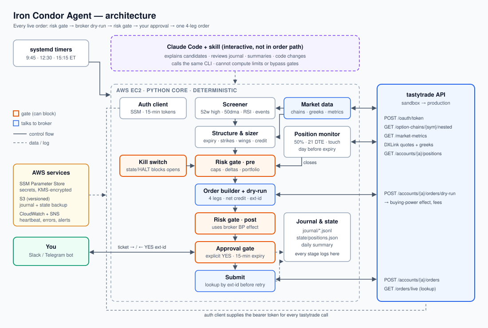
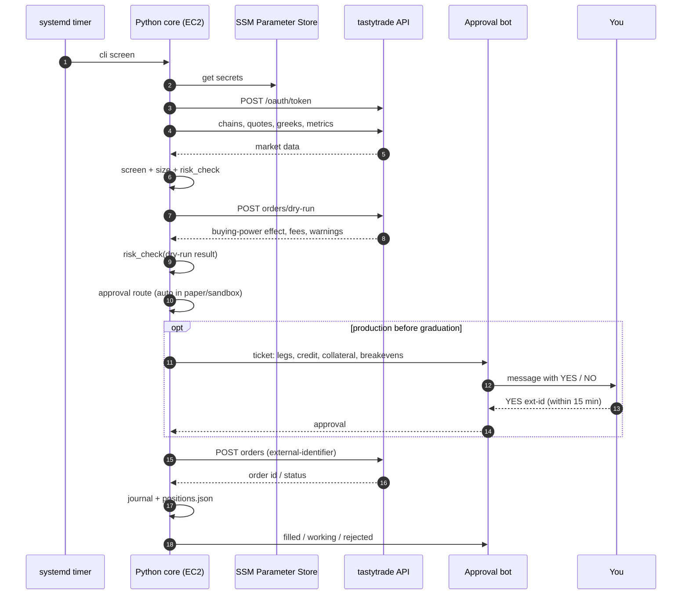
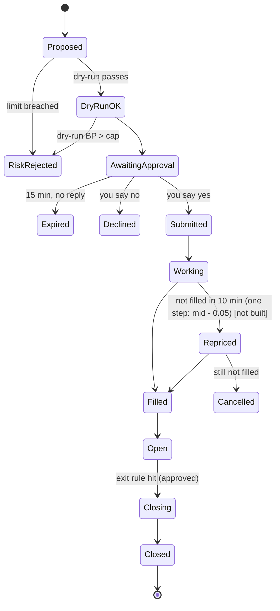

# Architecture



The agent runs on an AWS EC2 instance as a set of deterministic Python modules started by systemd timers. The Python core owns the whole order path: screen, size, risk check, broker dry-run, risk re-check, your approval, submit. **Every number that gates an order is computed in code, not by the model.** Claude Code (the `iron-condor-tastytrade` skill) can run the cycles and report on them, but it only calls the CLI: it never computes a number or places an order, and the timers run the same cycles without it, so a scheduled close never depends on Claude being reachable.

> **Status (2026-10-25):** built and tested offline: components 5–9, 11–13 and a paper broker. Paper mode uses Yahoo (modeled prices, Black-Scholes deltas) in place of components 3–4 and 9's tastytrade client. Not built: tastytrade auth/broker/market data, the approval bot transport, CloudWatch alarms. See [TODO.md](TODO.md). Deployment details: [deploy.md](deploy.md).

## Components

| # | Component | Responsibility | Deterministic? |
|---|---|---|---|
| 1 | **Scheduler** | systemd timers on EC2: screen (9:45 ET), monitor (12:30 and 15:15 ET), backup (every 15 min) | Yes |
| 2 | **Claude Code + skill (interactive)** | Explains candidates, reviews the journal, writes summaries, helps change code. Not in the scheduled order path | No (cannot bypass gates) |
| 3 | **Auth client** | Reads secrets from SSM Parameter Store; exchanges the refresh token for a 15-minute access token; saves a rotated refresh token back to SSM; fails closed | Yes |
| 4 | **Market data** | Option chains, quotes, greeks, underlying history, IV rank, earnings and ex-dividend dates | Yes |
| 5 | **Screener** | Applies the universe and base-screen rules from `strategy.yaml` | Yes |
| 6 | **Strike selector & sizer** | Picks expiry, short/long strikes, wing widths; computes credit, collateral, breakevens | Yes |
| 7 | **Risk gate** | Enforces hard limits in [risk.md](risk.md); runs before and after dry-run | Yes |
| 8 | **Order builder** | Builds the 4-leg JSON with net-credit limit and unique `external-identifier` | Yes |
| 9 | **Broker client** | `POST orders/dry-run`, `POST orders`, order lookup, positions, balances | Yes |
| 10 | **Approval gate + autonomy route** | `autonomy.py` decides per order: paper/sandbox submit on their own (`approval.mode: auto`); production waits for a human unless graduation is met (30 closed live condors, 0 breaches, 0 unknown). The human path sends the ticket through a Slack (Socket Mode) or Telegram bot, accepts `YES <external-identifier>` only from your user ID, expires after 15 min. Transport not built yet | Yes |
| 11 | **Position monitor** | Evaluates exit rules on open condors and proposes closes through the same path | Yes |
| 12 | **Journal & state** | Append-only JSONL journal; `positions.json`; daily summary | Yes |
| 13 | **Kill switch** | A file (`state/HALT`) or env flag that blocks all new orders; closes are still allowed | Yes |
| 14 | **Ops** | S3 backup of `journal/` and `state/`; CloudWatch heartbeat and error metrics; SNS alerts | Yes |
| 15 | **Paper broker** | Simulated $5,000 account; fills at the limit price; same interface as the real broker | Yes |
| 16 | **Dashboard** | Read-only page on the box, loopback or Tailscale address only; shows account, positions, P&L, halt, journal | Yes |

## Data flow — opening a condor



## Order lifecycle



## Interfaces to tastytrade

| Purpose | Endpoint (per developer docs; verify in Phase 0) |
|---|---|
| Access token | `POST /oauth/token` (refresh-token grant) |
| Option chain | `GET /option-chains/{symbol}/nested` |
| Validate order | `POST /accounts/{account}/orders/dry-run` |
| Place order | `POST /accounts/{account}/orders` |
| Find order | `GET /accounts/{account}/orders/live` and `/orders` |
| Positions / balances | `GET /accounts/{account}/positions`, `/balances` |
| Quotes and greeks | DXLink streaming via `/api-quote-tokens` |
| IV rank, earnings, dividends | `GET /market-metrics?symbols=` |

Every request carries `Authorization: Bearer <token>` and `User-Agent: trading-agent/<version>`.

## Idempotency

The API does not dedupe retried submissions. So:

1. Each ticket gets an `external-identifier` = `ic-<ticker>-<expiry>-<uuid8>`, written to the journal **before** submit.
2. On timeout or 5xx, the broker client looks the identifier up in live and recent orders before any resend.
3. Found → adopt it. Not found after two lookups 5s apart → mark `UNKNOWN`, alert, and do **not** resend automatically.

## Failure handling

| Failure | Behavior |
|---|---|
| Token refresh fails | No orders; SNS alert; monitor runs read-only if a token is still valid |
| Scheduled run missing | CloudWatch heartbeat alarm → SNS |
| Instance failure | EC2 auto-recover; restore `journal/` and `state/` from S3 |
| Approval bot down | Tickets expire unsubmitted; SNS alert still reaches you |
| Market data missing a field | Exclude that name; journal the reason |
| Dry-run returns warnings or 422 | Drop the ticket; journal the error codes |
| Dry-run buying-power effect > cap | Risk gate rejects |
| Partial ambiguity after submit | `UNKNOWN` state, alert, manual resolution via [runbook.md](runbook.md) |
| Early assignment detected | Halt new opens; alert; propose closing the remaining legs |
| Kill switch present | Block opens; still allow approved closes |

## Storage

```
state/
  positions.json      # open condors, legs, entry credit, exit flags
  paper_account.json  # paper broker cash, reserved collateral, orders
  HALT                # present = kill switch on
journal/
  2026-10-27.jsonl    # one line per event: screen, proposal, dry-run, approval, submit, fill, close
config/
  strategy.yaml       # all tunable numbers (copied from strategy.example.yaml)
.env                  # non-secret settings only: TT_ENV, TA_APPROVAL_CHANNEL, TA_HALT, AWS_REGION
```

Secrets (client ID/secret, refresh token, account number, bot token) live in SSM Parameter Store under `/trading-agent/<env>/`. `state/` and `journal/` sync to a versioned S3 bucket every 15 minutes. `state/`, `journal/` and `.env` are gitignored.

## Proposed code layout

```
src/trading_agent/
  auth.py          # token exchange and refresh
  broker.py        # REST client: dry-run, submit, lookup, positions
  marketdata.py    # chains, quotes, greeks, metrics, history
  screen.py        # universe + base screen
  structure.py     # expiry, strikes, wings, sizing
  risk.py          # hard limits, pre and post dry-run
  orders.py        # 4-leg JSON builder, external-identifier
  approval.py      # notify + wait for yes
  monitor.py       # exit rules on open condors
  journal.py       # JSONL + positions.json
  ops.py           # S3 backup, CloudWatch metrics
  cli.py           # status | halt | screen --dry | run-open | run-monitor | backup | dashboard
  autonomy.py      # human vs auto approval route, production graduation test
  paper.py         # simulated broker
  engine.py        # open_cycle, monitor_cycle, close_position
  pipeline.py      # risk -> dry-run -> risk -> route -> submit for one condor
  positions.py     # positions.json, realized P&L, order count
  assignment.py    # early-assignment detection (not yet wired to a broker feed)
  prices_yahoo.py, options_yahoo.py, indicators.py, universe.py, calendar_us.py
  dashboard.py, web/index.html
tests/
skills/iron-condor-tastytrade/SKILL.md
```

## Security

- OAuth2 only. No passwords anywhere; secrets in SSM Parameter Store (KMS-encrypted), held in memory only.
- The instance role can read only `/trading-agent/*` parameters, write only the refresh token, and write only to its own S3 bucket and CloudWatch namespace.
- No inbound security-group rules; admin access through SSM Session Manager. The dashboard binds to loopback or a Tailscale address only and refuses anything else.
- Runs as its own unprivileged user, separate from the Robinhood agents.
- The agent cannot transfer money; the token scope is trading only.
- Secrets never appear in logs, journal lines or chat messages.
- Orders are only built from the agent's own screen; instructions found in news, filings or web pages are treated as data.
