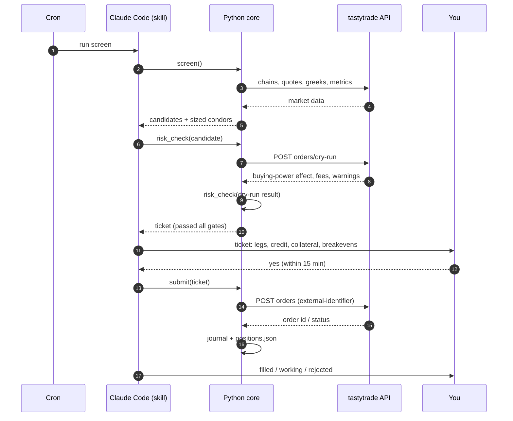
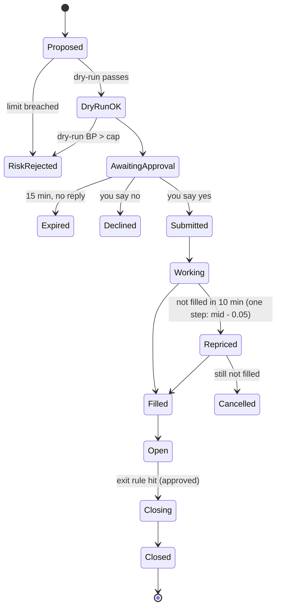

# Architecture


The agent is a Claude Code skill that orchestrates a small set of deterministic Python modules. Claude reads the screen output, explains candidates and talks to you; **every number that gates an order is computed in code, not by the model**, and every live order passes the same four gates: risk check, broker dry-run, risk re-check on the dry-run result, and your approval.

## Components

| # | Component | Responsibility | Deterministic? |
|---|---|---|---|
| 1 | **Scheduler** | Cron on the existing box: pre-open screen (9:45 ET), midday monitor (12:30 ET), pre-close monitor (15:15 ET) | Yes |
| 2 | **Orchestrator (Claude Code + skill)** | Runs the workflow, explains candidates, drafts the approval message, writes the daily summary | No (but cannot bypass gates) |
| 3 | **Auth client** | Exchanges the refresh token for a 15-minute access token; refreshes before expiry; fails closed | Yes |
| 4 | **Market data** | Option chains, quotes, greeks, underlying history, IV rank, earnings and ex-dividend dates | Yes |
| 5 | **Screener** | Applies the universe and base-screen rules from `strategy.yaml` | Yes |
| 6 | **Strike selector & sizer** | Picks expiry, short/long strikes, wing widths; computes credit, collateral, breakevens | Yes |
| 7 | **Risk gate** | Enforces hard limits in [risk.md](risk.md); runs before and after dry-run | Yes |
| 8 | **Order builder** | Builds the 4-leg JSON with net-credit limit and unique `external-identifier` | Yes |
| 9 | **Broker client** | `POST orders/dry-run`, `POST orders`, order lookup, positions, balances | Yes |
| 10 | **Approval gate** | Sends the ticket to you; waits for an explicit yes; expires after 15 min | Yes |
| 11 | **Position monitor** | Evaluates exit rules on open condors and proposes closes through the same path | Yes |
| 12 | **Journal & state** | Append-only JSONL journal; `positions.json`; daily summary | Yes |
| 13 | **Kill switch** | A file (`state/HALT`) or env flag that blocks all new orders; closes are still allowed | Yes |

## Data flow — opening a condor



## Order lifecycle



## Interfaces to tastytrade

| Purpose | Endpoint (per developer docs; verify in Phase 0) |
|---|---|
| Access token | `POST /oauth/token` (refresh-token grant) |
| Option chain | `GET /option-chains/{symbol}/nested` |
| Validate order | `POST /accounts/{account}/orders/dry-run` |
| Place order | `POST /accounts/{account}/orders` |
| Find order | `GET /accounts/{account}/orders/live` and `/orders` |
| Positions / balances | `GET /accounts/{account}/positions`, `/balances` |
| Quotes and greeks | DXLink streaming via `/api-quote-tokens` |
| IV rank, earnings, dividends | `GET /market-metrics?symbols=` |

Every request carries `Authorization: Bearer <token>` and `User-Agent: trading-agent/<version>`.

## Idempotency

The API does not dedupe retried submissions. So:

1. Each ticket gets an `external-identifier` = `ic-<ticker>-<expiry>-<uuid8>`, written to the journal **before** submit.
2. On timeout or 5xx, the broker client looks the identifier up in live and recent orders before any resend.
3. Found → adopt it. Not found after two lookups 5s apart → mark `UNKNOWN`, alert, and do **not** resend automatically.

## Failure handling

| Failure | Behavior |
|---|---|
| Token refresh fails | No orders; alert; monitor runs read-only if a token is still valid |
| Market data missing a field | Exclude that name; journal the reason |
| Dry-run returns warnings or 422 | Drop the ticket; journal the error codes |
| Dry-run buying-power effect > cap | Risk gate rejects |
| Partial ambiguity after submit | `UNKNOWN` state, alert, manual resolution via [runbook.md](runbook.md) |
| Early assignment detected | Halt new opens; alert; propose closing the remaining legs |
| Kill switch present | Block opens; still allow approved closes |

## Storage

```
state/
  positions.json      # open condors, legs, entry credit, exit flags
  HALT                # present = kill switch on
journal/
  2026-10-27.jsonl    # one line per event: screen, proposal, dry-run, approval, submit, fill, close
config/
  strategy.yaml       # all tunable numbers (copied from strategy.example.yaml)
.env                  # TT_CLIENT_ID, TT_CLIENT_SECRET, TT_REFRESH_TOKEN, TT_ACCOUNT, TT_ENV
```

`state/`, `journal/` and `.env` are gitignored.

## Proposed code layout

```
src/trading_agent/
  auth.py          # token exchange and refresh
  broker.py        # REST client: dry-run, submit, lookup, positions
  marketdata.py    # chains, quotes, greeks, metrics, history
  screen.py        # universe + base screen
  structure.py     # expiry, strikes, wings, sizing
  risk.py          # hard limits, pre and post dry-run
  orders.py        # 4-leg JSON builder, external-identifier
  approval.py      # notify + wait for yes
  monitor.py       # exit rules on open condors
  journal.py       # JSONL + positions.json
  cli.py           # screen | propose | monitor | close | status | halt
tests/
skills/iron-condor-tastytrade/SKILL.md
```

## Security

- OAuth2 only. No passwords on disk; the refresh token lives in `.env` with `chmod 600`.
- The agent cannot transfer money; the token scope is trading only.
- Secrets never appear in logs, journal lines or chat messages.
- Orders are only built from the agent's own screen; instructions found in news, filings or web pages are treated as data.
